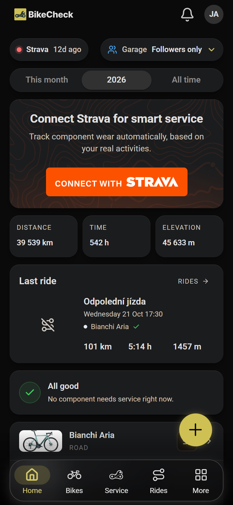
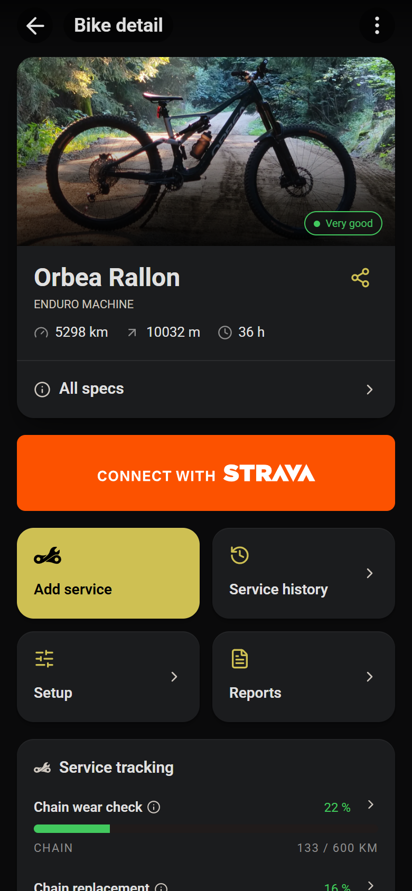
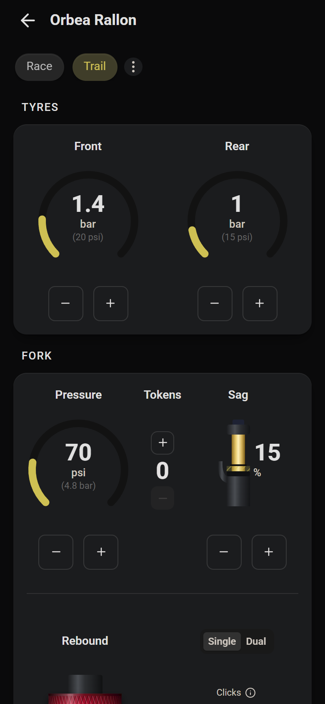
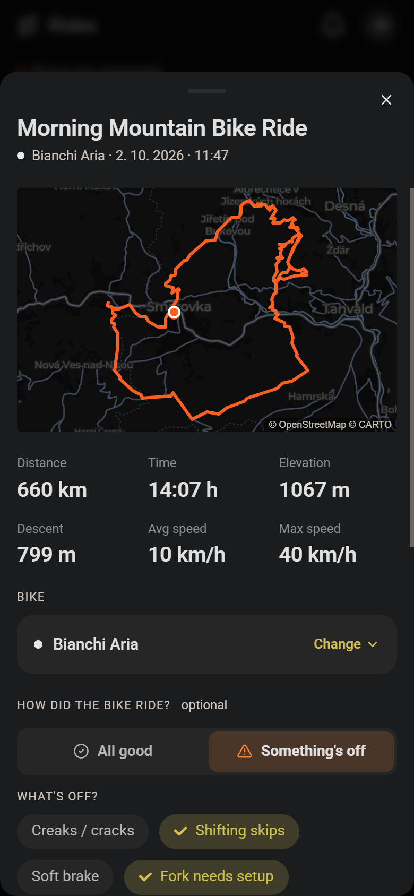
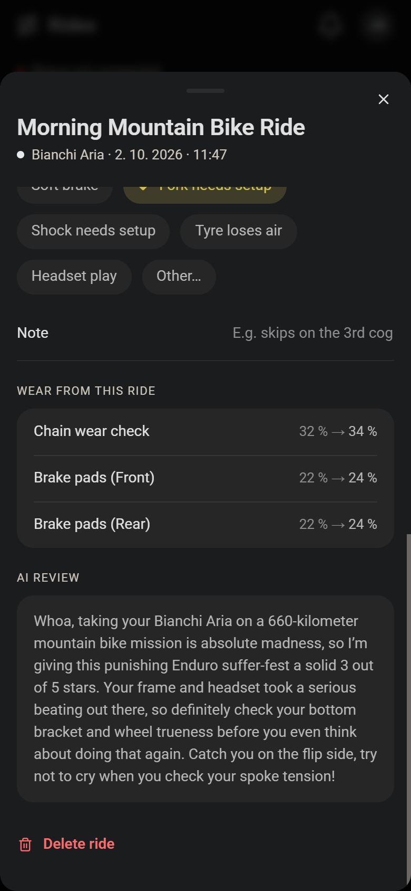
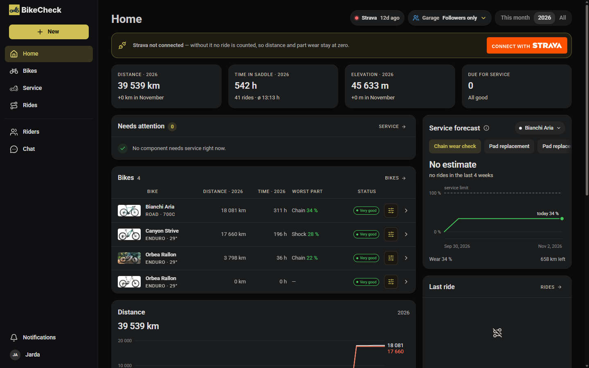
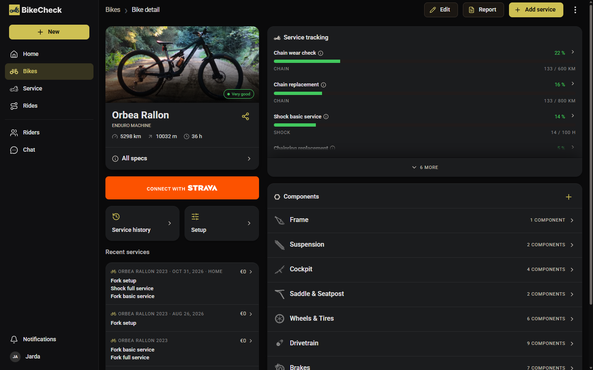
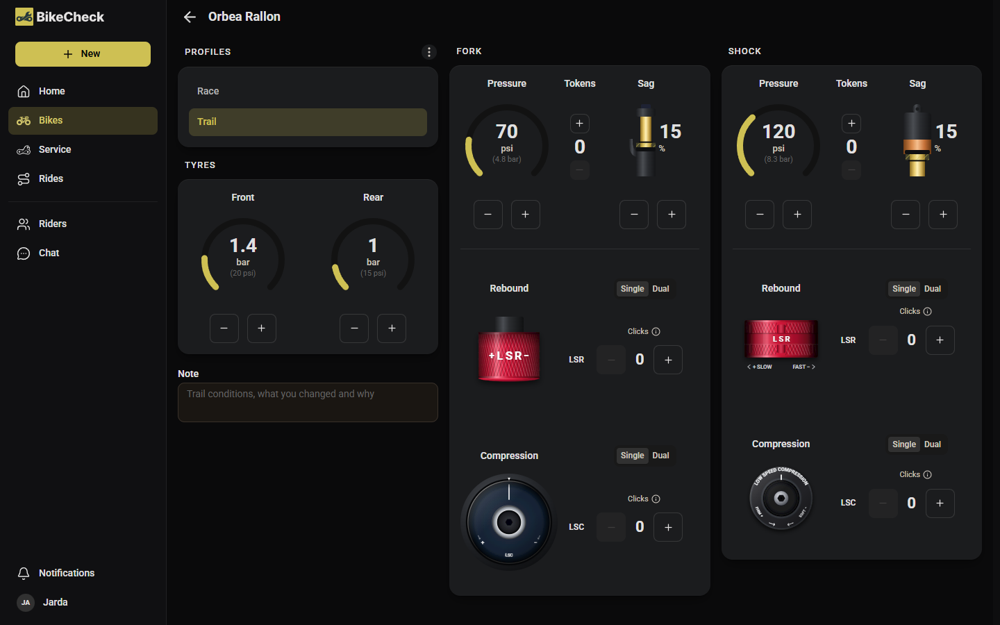
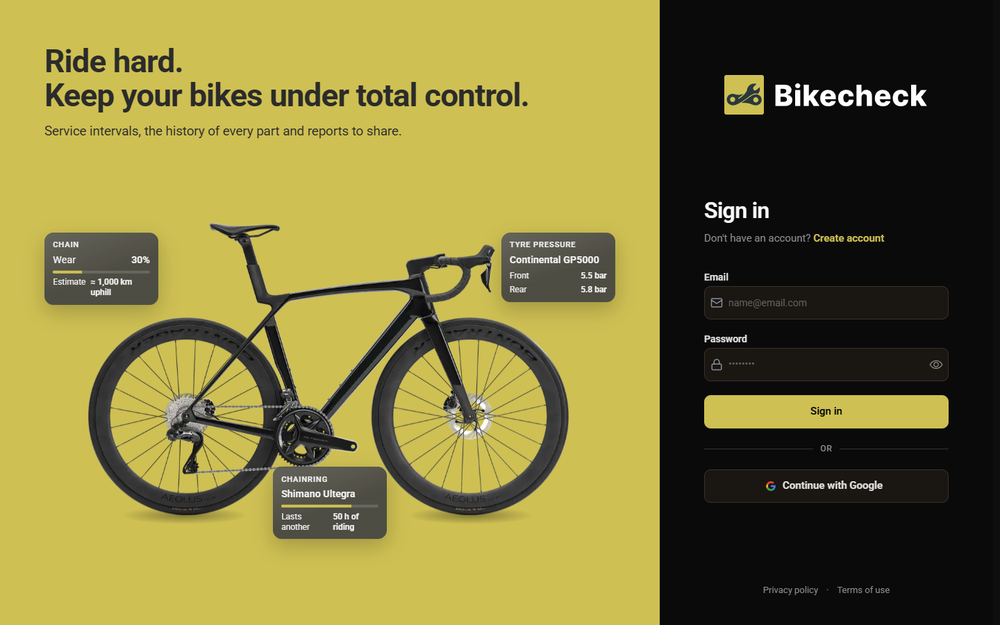
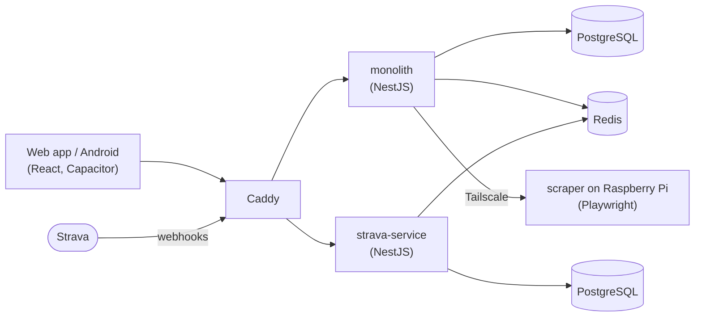

# BikeCheck

Track your bikes, their components and their maintenance. Rides synced from Strava wear each part
down, so BikeCheck tells you when it needs attention.

**[bikecheck.cloud](https://bikecheck.cloud)** · **[Open the app](https://app.bikecheck.cloud)** ·
Android app in testing on Google Play

## Screenshots

### Mobile

<p align="center">
  
  
  
  
  
</p>

### Desktop

| Home | Bike detail |
|---|---|
|  |  |
| **Suspension setup** | **Sign in** |
|  |  |

## Features

- **Bikes & components** - a garage of bikes, each with the parts mounted on it
- **Wear tracking** - rides wear every part down, and the app shows when each one is due for service
- **Service log** - record what was done to which part, and browse the history
- **Suspension setup** - pressure, tokens, sag and clicks for fork and shock, kept in profiles
- **Strava sync** - rides arrive on their own and land on the right bike
- **AI chat** - ask about your own data, like "what needs service soon?"
- **Reports** - export the service history as a PDF, publish it and share a link
- **Riders** - follow other riders and show your garage
- **Notifications** - a heads-up when a part needs attention

## Tech stack

| | |
|---|---|
| **Frontend** | React 19, TypeScript, Mantine, Tailwind CSS, Vite, TanStack Query, Capacitor (Android) |
| **Backend** | NestJS monorepo (monolith, strava-service, scraper), TypeScript, BullMQ |
| **Data** | PostgreSQL (Prisma in the monolith, node-pg-migrate in strava-service), Redis |
| **Integrations** | Strava API and webhooks, Playwright (PDF printing, scraping) |
| **Infrastructure** | Docker, Caddy, GitHub Actions, GitHub Container Registry, Hetzner, Raspberry Pi, Tailscale |
| **Observability** | Grafana, Loki, Alloy, Umami |



## Engineering highlights

- **Wear is computed on read.** A part's service progress is never stored; it is derived from the
  ride totals, the last service and the interval each time it is read. Nine write paths could move
  those inputs, and none of them can leave a stale number behind
  ([ADR 0026](docs/adr/0026-service-tracking-is-computed-on-read.md)).
- **A modular monolith with two microservices.** The NestJS monolith carries the domain. Strava
  webhooks and OAuth live in their own service with their own database and queue, and the bike
  scraper is a third app, so each deploys and fails on its own.
- **The scraper runs at home.** Cloudflare blocked bike searches from the datacenter and through
  every proxy tried, so a headless Chromium runs on a Raspberry Pi at home and the monolith calls it
  over Tailscale. The options were measured before the choice was made
  ([ADR 0042](docs/adr/0042-the-bike-scraper-runs-at-home.md)).
- **No AI over Strava data.** Strava's API policy bans it, so rides never reach a language model and
  the AI ride review is gone ([ADR 0047](docs/adr/0047-no-ai-over-strava-data.md)).
- **Release by tag.** Pushing a `vX.Y.Z` tag runs the checks, builds four images from two
  Dockerfiles in one build matrix (the scraper natively on ARM), pushes them to GHCR and deploys to
  the server ([docs/deploy.md](docs/deploy.md)).
- **Decisions are written down.** 44 architecture decision records in [docs/adr](docs/adr) and a
  domain glossary in [CONTEXT.md](CONTEXT.md).

## Getting started

Requires Node 22 and Docker. The `.env` files are not in the repository; they are available from
the author on request.

```bash
git clone https://github.com/Jaffator/bikecheck-app.git
cd bikecheck-app
docker compose up -d                       # PostgreSQL x2, Redis, Loki, Grafana

cd _backend && npm install
npx prisma migrate deploy --config apps/monolith/prisma.config.ts
npm run monolith_app:start:dev             # API on :3000
npm run strava_app:start:dev               # in a second terminal

cd ../_frontend/bikecheck && npm install
npm run dev                                # app on :5173
```

The full setup, including moving data from another machine and running the tests, is in
[docs/dev-setup.md](docs/dev-setup.md).

## Project structure

```
_backend/
  apps/monolith/        the API: bikes, parts, service, rides, reports, AI
  apps/strava-service/  Strava webhooks, OAuth tokens and ride sync
  apps/scraper/         headless bike search, runs on the Raspberry Pi
  libs/                 code shared by the apps
_frontend/bikecheck/    the web and Android app
_website_landing/       the marketing site at bikecheck.cloud
docker/                 Caddy, Loki and Alloy configuration
docs/                   decisions, design, deploy and setup guides
```

## Documentation

- [CONTEXT.md](CONTEXT.md) - the domain glossary
- [docs/adr](docs/adr) - architecture decision records
- [docs/design.md](docs/design.md) - the design system
- [docs/deploy.md](docs/deploy.md) - releases and deployment
- [docs/dev-setup.md](docs/dev-setup.md) - setting up a development machine

## License

[MIT](LICENSE)

## Author

Jaroslav Lufinka · [LinkedIn](https://www.linkedin.com/in/jaroslav-lufinka/)
